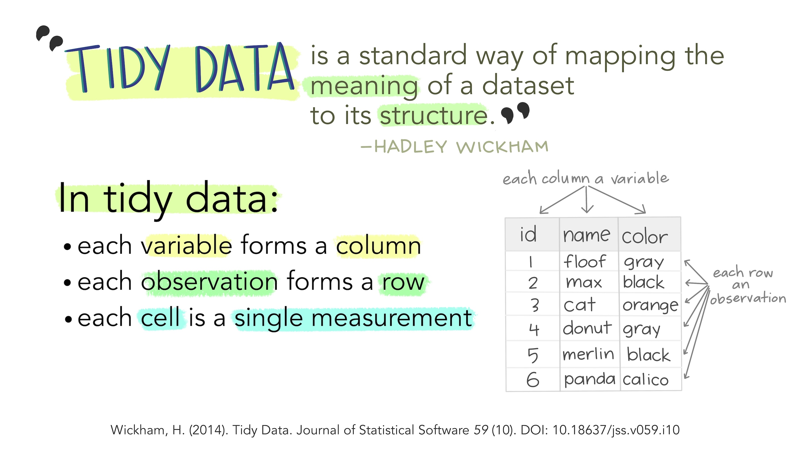

---
title: "Module 2 Assignment"
---


```{r setup, include=FALSE}
knitr::opts_chunk$set(echo = TRUE, message = FALSE, warning = FALSE)
```

```{r, echo = FALSE, message = FALSE, warning = FALSE}
library(readxl)
library(knitr)
library(tidyverse)
due_dates <- read_excel("../../../files/schedule_modules.xlsx",
                       sheet = "module_due_dates_2026")
```

```{r, echo = FALSE}
module_2_due_date <- due_dates |> 
  filter(Assignment == "Module 2: Coding Fundamentals") |> 
  pull(due_date_paste)
```

::: callout-important
This assignment will be due on **`r module_2_due_date` at 11:59pm**.
:::

## Introduction
This is your assignment for Module 2, focused on the material you learned in the lectures and recitation activities on R Markdown, wrangling, ggplot101, and ggplot102. This assignment is worth 8 points.

Submission info: you will submit this assignment by uploading a knitted `.html` to Carmen that you created from an R Markdown or Quarto document. 

- Make sure you include the `Code Download` button or another way to download your code
- Show your code within your knitted `.html`
- Customize the YAML and the document so you like how your final report looks - do check this before you submit
- All code should be annotated (meaning, you should be writing descriptions in your own words about what the code is doing)
- All decisions should be described in the text of your document

::: {.callout-caution}
## A reminder about generative AI use
Please remember that you can use generative AI to help with your coding, but it should **NOT** be used to generate your assignment text or on conceptual questions. You should be able to explain your code and your decisions in your own words. If you use generative AI for your code, please cite:

1) what the goal of the use was
2) your prompt
3) what you got
4) what edits you made

:::

## Why are you doing this?

The purpose of this assignment is to demonstrate that you are able to:

1. Look at data and choose a suitable chart type for that data
2. Use R and R Markdown/quarto to create a visualization that executes on your decisions in #1.

## 1. Provide feedback to improve an existing figure (2 points)

One of your lab mates presents the figure below in lab meeting and it is your job to give them constructive feedback how to improve this figure to best communicate the data. The data below shows the yield of different peppers for 20 different genotypes under two different treatments, where water is limited or not limited. The different colors represent the different categories of peppers, those that are collected that are green (this is the color they should be), those that are red (this is another color they should be), those that are rotten (this is bad) and those that are unmarketable (those are also not desirable). Your main question is to understand how pepper genotypes perform under the two different water conditions. 

```{r echo = FALSE}
library(tidyverse)
library(readxl)

peppers <- read_excel("peppers.xlsx") |> 
  rename(Rotten = BER)

peppers_tidy <- peppers |> 
  pivot_longer(cols = Green:Unmarketable,
              names_to = "Quality",
              values_to = "Yield")

peppers_tidy |> 
  ggplot(aes(x = Genotype, y =  Yield, fill = Quality)) +
  geom_col(position = "stack") + # make a stacked bar plot
  facet_wrap(vars(Treatment)) + # facet by treatment
  theme(
    axis.text.x = element_text(angle = 45, hjust = 1), # make the x-axis text on a 45degree angle
    legend.position = "bottom" # move legend to bottom
  )              
```

Provide 4 things you could try to improve this figure and describe why each would be an improvement over the current version.

What I provide below is not an exhaustive list, but I tried to focus on the bigger, more substantive changes that you could make to improve the plot and presentation of this data.

### 1. Organize the plot around the comparison that is the most important

In this case, the comparison of genotypes under water sufficient and water limiting conditions. We could instead facet by genotype and have the x-axis be the water treatment. Let's see how that would look:

```{r}
peppers_tidy |> 
  ggplot(aes(x = Treatment, y =  Yield, fill = Quality)) +
  geom_col(position = "stack") +
  facet_wrap(vars(Genotype)) +
  theme(
    axis.text.x = element_text(angle = 45, hjust = 1),
    legend.position = "bottom"
  )              
```

When we do this, certain treatments now stand out -- like P12 which is high in both non-limited and water-limited conditions.

### 2. Order genotypes by something experimentally relevant

Instead I could try and order the genotypes by total yield (sum of all the quality traits) in the non-limited treatment, and then instead of putting the plots side by side, I could stack them top to bottom, and order the water limited samples in the same order. Let's see how that looks.

```{r}
# calculate the total yield
# and sort the df by decreasing yield in the non-limited condition
peppers_total_yield <- peppers_tidy |> 
  group_by(Genotype, Treatment) |> 
  summarize(total_yield = sum(Yield)) |> 
  filter(Treatment == "Non-limited") |> 
  arrange(-total_yield)

knitr::kable(peppers_total_yield)
```

```{r}
# create a vector with the order we want for the genotypes for total yield
genotype_totalyield_order <- peppers_total_yield$Genotype

# check our order
genotype_totalyield_order

# relevel according to genotype_totalyield_order
peppers_tidy$Genotype <- factor(peppers_tidy$Genotype, 
                                levels = genotype_totalyield_order)

# check to see if it worked
glimpse(peppers_tidy)

peppers_tidy |> 
  ggplot(aes(x = Genotype, y = Yield, fill = Quality)) +
  geom_col(position = "stack") +
  facet_grid(vars(Treatment)) +
  labs(title = "Pepper yield under water sufficient and water limiting conditions",
       subtitle = "Genotypes are ordered based on decreasing total yield in sufficient conditions") +
  theme(
    axis.text.x = element_text(angle = 45, hjust = 1),
    legend.position = "bottom"
  )              
```

We could also think about whether total yield is the most relevant metric, or whether green + red would be more useful for ordering.

```{r}
# calculate yield for good quality peppers (green + red)
peppers_good_yield <- peppers_tidy |> 
  filter(Quality %in% c("Green", "Red")) |> 
  group_by(Genotype, Treatment) |> 
  summarize(good_yield = sum(Yield)) |> 
  filter(Treatment == "Non-limited") |> 
  arrange(-good_yield)

# create a vector with the order we want for the genotypes for total yield
genotype_goodyield_order <- peppers_good_yield$Genotype

# check our order
genotype_goodyield_order

# relevel according to genotype_totalyield_order
# create a new df so we can go back to peppers_tidy if we want
peppers_tidy_goodyield <- peppers_tidy

peppers_tidy_goodyield$Genotype <- factor(peppers_tidy_goodyield$Genotype, 
                                          levels = genotype_goodyield_order)

# check to see if it worked
glimpse(peppers_tidy_goodyield)

peppers_tidy_goodyield |> 
  ggplot(aes(x = Genotype, y = Yield, fill = Quality)) +
  geom_col(position = "stack") +
  facet_grid(vars(Treatment)) +
  labs(title = "Pepper yield under water sufficient and water limiting conditions",
       subtitle = "Genotypes are ordered based on decreasing \ngood quality pepper (i.e., green + red) yield in sufficient conditions") +
  theme(
    axis.text.x = element_text(angle = 45, hjust = 1),
    legend.position = "bottom"
  )      
```

Comparing this plot to the previous one can help us understand differences in genotypes that are high yielding but not necessarily high in good quality peppers.

### 3. Improve the coloring of the plot to make it more intuitive

Make the colors of the plot more intuitive. For example, we could make the green peppers green, the red peppers red, and the rotten and unmarketable peppers shades of brown. This would make it easier to understand the plot at a glance.

Let's start with the plot we made where we ordered the genotypes by total yield in the non-limited condition, and change the colors of the plot.

```{r}
peppers_tidy |> 
  ggplot(aes(x = Genotype, y = Yield, fill = Quality)) +
  geom_col(position = "stack", 
           color = "black") + # outline the bars in black to see more easily
  scale_fill_manual(values = c("Green" = "#156110", 
                               "Red" = "#DE2212", 
                               "Rotten" = "#613310", 
                               "Unmarketable" = "black")) +
  facet_grid(vars(Treatment)) +
  labs(title = "Pepper yield under water sufficient and water limiting conditions",
       subtitle = "Genotypes are ordered based on decreasing total yield in sufficient conditions") +
  theme_bw() +
  theme(
    axis.text.x = element_text(angle = 45, hjust = 1),
    legend.position = "bottom"
  ) 
```


What if we make this color change to the plot where we faceted by genotype, and then ordered the facets based on total yield in the non-limited condition? Since we've converted `Genotype` into a factor, the facets will now be in the same order as the levels of `Genotype`. 

```{r}
peppers_tidy |> 
  ggplot(aes(x = Treatment, y = Yield, fill = Quality)) +
  geom_col(position = "stack", 
           color = "black") + # outline the bars in black to see more easily
  scale_fill_manual(values = c("Green" = "#156110", 
                               "Red" = "#DE2212", 
                               "Rotten" = "#613310", 
                               "Unmarketable" = "black")) +
  facet_wrap(vars(Genotype), ncol = 5) +
  labs(title = "Pepper yield under water sufficient and water limiting conditions",
       subtitle = "Genotypes are ordered based on decreasing total yield in sufficient conditions") +
  theme_bw() +
  theme(
    axis.text.x = element_text(angle = 45, hjust = 1),
    legend.position = "bottom"
  )
```

### 4. Calculate differences and plot that directly 

Calculate the difference in yield between the two treatments for each genotype and plot that instead. This would make it easier to see which genotypes are more tolerant to water limiting conditions. In this case, I am also reordering the `Genotypes` on the x-axis based on the difference under the two conditions.

```{r}
# first we can calculate the difference in yield between the two water treatments
peppers_tidy |> 
  group_by(Genotype, Treatment) |> # group the data by genotype and treatment
  summarize(total_yield = sum(Yield)) |>  # calculate total yield
  pivot_wider(names_from = Treatment, values_from = total_yield) |> # pivot wider so that the two treatments are in their own columns
  mutate(difference = `Non-limited` - `Water-limited`) |> # calculate the difference between the two conditions
  arrange(difference) |> # arrange the data by that difference
# now we can start plotting
  ggplot(aes(x = reorder(Genotype, difference), y = difference)) +
  geom_col() +
  labs(title = "Difference in yield between water limited and water sufficient conditions",
       subtitle = "Smaller values mean a smaller yield penalty under water limiting conditions, \ngenotypes are ordered based on increasing difference in yield",
       x = "Genotype",
       y = "Difference in Yield") +
  theme_bw() +
  theme(
    axis.text.x = element_text(angle = 45, hjust = 1),
    legend.position = "bottom"
  )
```

Here we can see that P12, followed by P11 have the smallest difference between the two treatments, indicating that they have less of a yield penalty under water limiting conditions.

We could also order this plot by total yield so that we can see how these two are related, since a pepper with a small difference, but with a low overall yield is not something that would be of interest.

```{r, message = FALSE, warning = FALSE}
# first we can calculate the difference in yield between the two water treatments
peppers_tidy |> 
  group_by(Genotype, Treatment) |> # group the data by genotype and treatment
  summarize(total_yield = sum(Yield)) |>  # calculate total yield
  pivot_wider(names_from = Treatment, values_from = total_yield) |> # pivot wider so that the two treatments are in their own columns
  mutate(difference = `Non-limited` - `Water-limited`) |> # calculate the difference between the two conditions
  arrange(difference) |> # arrange the data by that difference
  ungroup() |> # remove the grouping factor 
# now we can start plotting
  ggplot(aes(x = reorder(Genotype, genotype_totalyield_order), y = difference)) +
  geom_col() +
  labs(title = "Difference in yield between water limited and water sufficient conditions",
       subtitle = "Smaller values mean a smaller yield penalty under water limiting conditions, \ngenotypes are ordered based on decreasing total yield",
       x = "Genotype, ordered by Total Yield from highest (left) to lowest (right)",
       y = "Difference in Yield") +
  theme_bw() +
  theme(
    axis.text.x = element_text(angle = 45, hjust = 1),
    legend.position = "bottom"
  )
```

We can see something different here -- we see that P12 is in the bottom 30% of yield, so we probably wouldn't want to pursue that genotype, even though it has a small yield penalty under water limiting conditions. P11 is also similarly not good.

Alternatively we could color by total yield while still ordering on the x-axis with increasing difference between the two water treatments. This would allow us to see which genotypes have a small yield penalty under water limiting conditions, but also have a high overall yield.

```{r}
# first we can calculate the difference in yield between the two water treatments
peppers_diff_totalyield <- peppers_tidy |> 
  group_by(Genotype, Treatment) |> # group the data by genotype and treatment
  summarize(total_yield = sum(Yield)) |>  # calculate total yield
  pivot_wider(names_from = Treatment, values_from = total_yield) |> # pivot wider so that the two treatments are in their own columns
  mutate(difference = `Non-limited` - `Water-limited`) |> # calculate the difference between the two conditions
  arrange(difference) |> # arrange the data by that difference
  ungroup() # remove the grouping factor 

# join the new df we jhust made with the total yield data we calculated earlier
peppers_diff_totalyield <- left_join(peppers_diff_totalyield, peppers_total_yield, by = "Genotype") 

# now we can start plotting
peppers_diff_totalyield |>
  ggplot(aes(x = reorder(Genotype, difference), y = difference, fill = total_yield)) +
  geom_col() +
  labs(title = "Difference in yield between water limited and water sufficient conditions",
       subtitle = "Smaller values mean a smaller yield penalty under water limiting conditions, \ngenotypes are ordered based on decreasing total yield",
       x = "Genotype, ordered by Total Yield from highest (left) to lowest (right)",
       y = "Difference in Yield",
       fill = "Total Yield") + # changes the label in the legend 
  scale_fill_gradient(low = "lightgray", high = "black") + # adjust the color scale to be a gradient from light gray to black
  theme_bw() +
  theme(
    axis.text.x = element_text(angle = 45, hjust = 1),
  )
```

Looking at this all together helps us better understand our data.

## 2. Creating tidy data (2 points)

You are presented with data collected with yield data over 5 years that looks like this:

```{r, echo = FALSE}
yield <- read_excel("yield-year.xlsx")
```

```{r, echo = FALSE}
knitr::kable(yield)
```

You can download this data using this code for question 2c.

```{r, eval = FALSE}
# on a Mac/Linux
download.file("https://github.com/jcooperstone/jcooperstone.github.io/raw/refs/heads/main/assignments/modules/module2/yield-year.xlsx", 
              destfile = "yield-year.xlsx")

# on a Windows machine
download.file("https://github.com/jcooperstone/jcooperstone.github.io/raw/refs/heads/main/assignments/modules/module2/yield-year.xlsx", 
              destfile = "yield-year.xlsx", 
              mode = "wb")
```

### a. Describe in words what it means for data to be in a tidy format

In tidy data, each observation is a row, each variable is its own column, and each cell contains a single measurement. There are no data embedded in column names or row names, and there are no multiple values in a single cell. This structure allows us to use standardized tools and workflows for wrangling, analyzing, and plotting data.



### b. Describe in words how you would convert the dataframe above to be in a tidy format

For the dataset `yield`, we would need to convert the year columns (2022, 2023, 2024, 2026, 2026) into a single column called `Year`, and the corresponding yield values into a single column called `Yield`. This can be done using the `pivot_longer()` function from the `tidyverse` package, which will reshape the data from wide format to long format. This dataset in its wide form is not tidy becuase there is data (the year) embedded in the column names, and there are multiple values (the yield for each year) in a single row.

### c. Provide code for how you could convert this data to be in a tidy format

```{r, eval = FALSE}
# load in the yield data
yield <- read_excel("yield-year.xlsx")
```

Note if you keep the year names to be numbers, you need to refer to them in backticks.
```{r}
# save new tidy df called yield_tidy
yield_tidy <- yield |> 
  pivot_longer(cols = `2022`:`2026`, # specify the columns to pivot
               names_to = "Year", # name of the new column for years
               values_to = "Yield") # name of the new column for yield values

# check the structure
glimpse(yield_tidy)
```

## 3. Select the right plot for a dataset (2 points)

I am going to describe different types of data, and I'd like you to share:

- what type of question you would be asking with this data
- what type of plot would be best to visualize it
- why you picked that visualization
- how you would code that plot in words (but you don't actually need to code it)

**You do not need to actually create the plot** but I am going to make plots to try and better illustrate the types of data and plots that would be appropriate.

### a. The height and weight of a sample of 10,000 people from Ohio

- **Question 1**: What is the relationship between height and weight in a sample of 10,000 people from Ohio?
- **Type of plot**: Scatter plot
- **Why**: A scatterplot allows you to visualize the relationship between two continuous variables, height and weight, and can help identify patterns, trends, or correlations in the data.
- **How you would code in words**: Map weight to the `x` axis and height to the `y` axis, and use `geom_point()` to create a scatter plot.

First I am going to create a dummy, estimated dataset that has the weight and height of 10,000 people from Ohio based on information published by the [CDC](https://www.cdc.gov/obesity/data-and-statistics/adult-obesity-prevalence-maps.html).
```{r}
# Create a dataset with 10,000 people from Ohio
set.seed(123) # for reproducibility
ohio_height_weight_men <- data.frame(
  height = rnorm(5000, mean = 69, sd = 3), # 5000 men's height in inches
  weight = rnorm(5000, mean = 200, sd = 44),   # 5000 men's weight in kg
  sex = "male"
)

ohio_height_weight_women <- data.frame(
  height = rnorm(5000, mean = 63.5, sd = 2.8), # 5000 men's height in inches
  weight = rnorm(5000, mean = 172, sd = 47),   # 5000 men's weight in kg
  sex = "female"
)

ohio_height_weight <- rbind(ohio_height_weight_men, ohio_height_weight_women)
```

Now we can plot.
```{r}
ohio_height_weight |> 
  ggplot(aes(x = weight, y = height)) +
  geom_point(alpha = 0.5) + # add transparency to the points to avoid overplotting
  geom_smooth(method = "lm", color = "blue") + # add a linear regression line to show the trend 
  ggpubr::stat_regline_equation() + # add equation of regression line
  ggpubr::stat_regline_equation(aes(label = ..rr.label..), label.x = 10, label.y = 78) + # add R^2 and where it should go on the plot
  labs(title = "Relationship between height and weight in Ohio",
       x = "Weight (lbs)",
       y = "Height (inches)") +
  theme_minimal()
```

- **Question 2**: What is the distribution of heights and weights in the sample?
- **Type of plot**: Histogram or density plot
- **Why**: A histogram or density plot allows you to visualize the distribution of a single continuous variable, such as height or weight, and can help identify the shape of the distribution, see outliers etc.
- **How you would code in words**: Map height or weight to `x` and use `geom_histogram()` or `geom_density()` to create a histogram or density plot, respectively.

```{r}
ohio_height_weight |> 
# pivot data so we can make a faceted plot including both height and weight
  pivot_longer(cols = c(height, weight),
               names_to = "variable",
               values_to = "value") |>
 # now we plot               
  ggplot(aes(x = value, fill = sex)) + # map value (i.e. weight or height) to x, y is calculated
  geom_histogram(bins = 50) +
  facet_grid(cols = vars(variable), # make the variable (ie weight or height) the column
             rows = vars(sex),  # rows are sex so its easily to compare
             scales = "free") +
  theme_bw() +
  theme(legend.position = "none") + # don't need a legend bc we have the facets
  labs(title = "Distribution of height and weight in Ohio",
       x = "Value (height in inches and weight in lbs)",
       y = "Count")
```

### b. The expression level of 3 genes in treatment (n = 10) and control (n = 10) samples

- **Question**: How does the expression level of each gene differ between treatment and control samples?
- **Type of plot**: A boxplot with data jittered on top.
- **Why**: A boxplot allows you to see a 5 number summary (minimum, first quartile, median, third quartile, maximum) for the expression of each gene. Adding a jitter of the actual datapoints allows the viewer to see the full picture.
- **How would you code in words**: Map treatment to `x` and expression to `y`, and use `geom_boxplot()` to create the boxplot and add `geom_jitter()` to show the individual data points. Could also facet by gene to show the expression of each gene separately.

First I will create a fake dataset with 3 genes and 10 treatment and 10 control samples.
```{r}
set.seed(123) # for reproducibility
# Create a dataset with 3 genes and 10 treatment and 10 control samples
gene_expression <- data.frame(
  gene = rep(c("Gene1", "Gene2", "Gene3"), each = 20),
  treatment = rep(c("Control", "Treatment"), times = 30),
  expression = c(rnorm(10, mean = 5, sd = 1),
                 rnorm(10, mean = 7, sd = 1),
                 rnorm(10, mean = 6, sd = 1),
                 rnorm(10, mean = 8, sd = 1),
                 rnorm(10, mean = 4, sd = 1),
                 rnorm(10, mean = 6, sd = 1))
)

glimpse(gene_expression)
```

Let's plot.
```{r}
gene_expression |>
  ggplot(aes(x = treatment, y = expression, fill = treatment)) +
  geom_boxplot(outlier.shape = NA) + # don't show outliers since we are adding the jittered points
  geom_jitter(width = 0.2, alpha = 0.5) + # add jittered points to show the individual data points
  facet_wrap(vars(gene)) + # facet by gene
  theme_bw() +
  theme(legend.position = "none") + # don't need a legend bc we have the facets
  labs(title = "Expression level of 3 genes in treatment and control samples",
       x = "Treatment",
       y = "Expression level")

```

### c. The number of students in Ohio who got a PhD per year from 1950 until now

- **Question**: How has the number of students in Ohio who got a PhD changed over time?
- **Type of plot**: A line plot with time on the x-axis and the number of PhDs on the y-axis.
- **Why**: A line plot is ideal for showing trends over time.
- **How would you code in words**: Map year to `x` and number of PhDs to `y`, and use `geom_line()` to create the line plot. You could also add points with `geom_point()` to show the individual data points for each year.

I couldn't actually find this data, but could find info on the number of doctorates admissioned in the United States from 1958 to 2024 so I am going to use that instead to illustrate the concept.
```{r, echo = FALSE}
phds <- readxl::read_excel("nsf25349-tab001-001.xlsx",
                          skip = 3) |> 
            janitor::clean_names()

glimpse(phds)
```

```{r}
phds |> 
  ggplot(aes(x = year, y = doctorate_recipients_number)) +
  geom_line(color = "blue") +
  geom_point(color = "blue") +
  scale_y_continuous(labels = scales::comma) + # add a comma to the y-axis breaks
  theme_minimal() +
  labs(title = "Number of doctorates awarded in the United States from 1958 to 2024",
       x = "Year",
       y = "Number of doctorates")
```


### d. The amount of time spent studying and the grade achieved on the organic chemistry final for 200 students at Ohio State.

- **Question**: What is the relationship between the amount of time spent studying and the grade achieved on the organic chemistry final for 200 students at Ohio State?
- **Type of plot**: A scatter plot with a regression line.
- **Why**: A scatter plot allows you to visualize the relationship between two continuous variables, time spent studying and grade achieved. Adding a regression line can help identify trends or correlations in the data.
- **How would you code in words**: Map time spent studying to `x` and grade achieved to `y`, and use `geom_point()` to create the scatter plot. Add a regression line with `geom_smooth(method = "lm")` to show a linear trendline.

First I will create a dummy dataset containing 200 students with time spent studying and grade achieved on the organic chemistry final.
```{r}
set.seed(123) # for reproducibility

# create a variable study_time that is normally distributed with a mean of 10 hours and a standard deviation of 5 hours
study_time <- rnorm(200, mean = 10, sd = 5)

# create a variable called grade which is related to study time
grade <- 70 + 0.5 * study_time + rnorm(200, mean = 0, sd = 5)

# combine data together into a df
sample_data <- data.frame(study_time, grade)
```

Plot:
```{r}
sample_data |> 
  ggplot(aes(x = study_time, y = grade)) +
  geom_point(alpha = 0.5) + # add transparency to the points to avoid overplotting
  geom_smooth(method = "lm", color = "blue") + # add a linear regression line to show the trend 
  ggpubr::stat_regline_equation() + # add equation of regression line
  ggpubr::stat_regline_equation(aes(label = ..rr.label..), label.x = 3.5, label.y = 85) + # add R^2 and where it should go on the plot
  labs(title = "Relationship between time spent studying and grade achieved on the organic chemistry final",
       x = "Time spent studying (hours)",
       y = "Grade achieved (%)") +
  theme_minimal()
```

## 4. Recreate the following plot (2 points)

Recreate the following plot (as close as you can) which compiles the total number of PhDs awarded across different broad disciplines from 2008 to 2017. You can find the data here: [Number of PhDs awarded in the United States from 2008-2017, collated by the National Science Foundation](https://raw.githubusercontent.com/rfordatascience/tidytuesday/master/data/2019/2019-02-19/phd_by_field.csv)

::: {.callout-tip}
## You can use the code below to read this data into R:
```{r eval = FALSE}
readr::read_csv("https://raw.githubusercontent.com/rfordatascience/tidytuesday/master/data/2019/2019-02-19/phd_by_field.csv")
```

:::

```{r echo = FALSE, message = FALSE, warning = FALSE}
library(scales) # for comma format for numbers in number of PhDs plot

phd_field <- readr::read_csv("https://raw.githubusercontent.com/rfordatascience/tidytuesday/master/data/2019/2019-02-19/phd_by_field.csv")

# use summarize to calculate the total number of phds across each broad_field
broad_field_sum <- phd_field |>
  group_by(broad_field) |>
  summarize(broad_field_sum = sum(n_phds, na.rm = TRUE)) |>
  arrange(-broad_field_sum)

total_phds <- broad_field_sum |> 
  ggplot(aes(x = broad_field_sum, y = reorder(broad_field, broad_field_sum))) +
  geom_col(color = "black", fill = "gray") +
  scale_x_continuous(labels = comma) + # add a comma to the x-axis breaks
  theme_minimal() +
  labs(title = "Total PhDs awarded in the US across different \nbroad disciplines from 2008 to 2017",
       x = "Number of PhDs",
       y = "Broad field",
       subtitle = "Data collected by the National Science Foundation")

ggsave(filename = "total_phds.pdf", plot = total_phds)
```

```{r echo = FALSE}
total_phds
```

How to create this plot in words:

Since the data 

Getting set up, reading in data
```{r, message = FALSE, warning = FALSE}
# load packages that aren't already loaded
library(scales) # for comma format for numbers in number of PhDs plot

# read in data
phd_field <- readr::read_csv("https://raw.githubusercontent.com/rfordatascience/tidytuesday/master/data/2019/2019-02-19/phd_by_field.csv")

# look at the data
glimpse(phd_field)
```

Wrangle.
```{r}
# use summarize to calculate the total number of phds across each broad_field
broad_field_sum <- phd_field |>
  group_by(broad_field) |>
  summarize(broad_field_sum = sum(n_phds, na.rm = TRUE)) |>
  arrange(-broad_field_sum)
```

Plot. When you assign some code to a variable and wrap it in parentheses, it will print the output of that code in addition to saving it. This is a nice way to see your plot and also save it to a variable so you can save it as a file later. 
```{r}
(total_phds <- broad_field_sum |> 
  ggplot(aes(x = broad_field_sum, y = reorder(broad_field, broad_field_sum))) +
  geom_col(color = "black", fill = "gray") +
  scale_x_continuous(labels = comma) + # add a comma to the x-axis breaks
  theme_minimal() +
  labs(title = "Total PhDs awarded in the US across different \nbroad disciplines from 2008 to 2017",
       x = "Number of PhDs",
       y = "Broad field",
       subtitle = "Data collected by the National Science Foundation"))
```

## Deadlines

::: callout-important
This assignment will be due on **`r module_2_due_date` at 11:59pm**.
:::
