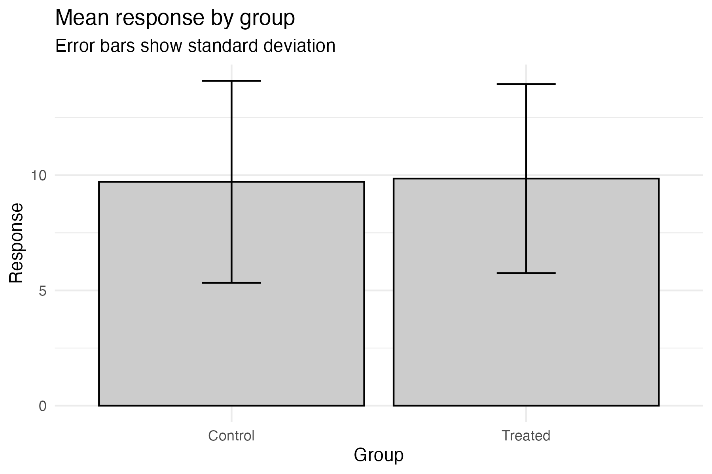

```{r setup, include=FALSE}
knitr::opts_chunk$set(echo = TRUE, message = FALSE, warning = FALSE)
```

```{r, echo = FALSE}
library(readxl)
library(knitr)
library(tidyverse)
due_dates <- read_excel("../../../files/schedule_modules.xlsx",
                       sheet = "module_due_dates_2026")
```

```{r, echo = FALSE}
module_3_due_date <- due_dates |> 
  filter(Assignment == "Module 3: Data Exploration") |> 
  pull(due_date_paste)
```

::: callout-important
This assignment will be due on **`r module_3_due_date` at 11:59pm**.
:::

## Introduction
This is your assignment for Module 3, focused on the material you learned in the lectures and recitation activities on data distributions, correlations, and annotating statistics. This assignment is worth 8 points.

**Submission info**: you will submit this assignment by uploading a knitted `.html` to Carmen that you created from an R Markdown or Quarto document. 

- Make sure you include the `Code Download` button or another way to download your code
- Show your code within your knitted `.html`
- Customize the YAML and the document so you like how your final report looks - do check this before you submit
- All code should be annotated (meaning, you should be writing descriptions in your own words about what the code is doing)
- All decisions should be described in the text of your document

::: {.callout-note}
Starting on this assignment, I will be considering for **overall format and readability of your assignment as part of your grade**. I am doing this because the format of your report will be considered for your final capstone assignment. This means you should have reasonable headers and header levels, understandable flow between plots and code, and use Markdown language when appropriate. If a question has subparts, they should be labelled so they are easily distinguishable.
:::

::: {.callout-caution}
## A reminder about generative AI use
Please remember that you can use generative AI to help with your coding, but it should **NOT** be used to generate your assignment text or on conceptual questions. You should be able to explain your code and your decisions in your own words. If you use generative AI for your code, please cite:

1) what the goal of the use was
2) your prompt
3) what you got
4) what edits you made
:::

## 1. Understanding data distributions (4 points)

Load the following data and create a series of 3 plots that help you understand the underlying data distribution. Order your plots from providing the least to the most information. Each plot should be complete with appropriate labels and titles. For each plot, provide:

a. the reason you selected that plot
b. the code used to create the plot with annotation for each step

After creating these 3 plots, provide a short paragraph (~5 sentences) summarizing what you learned about the data distribution from your plots, and which you think is the most informative. 

:::{.callout-note}
Remember, you can use AI to help you with the code, but **not** in the selection of the plot.
:::

You can download the data here. The data includes 198 observations of a response variable (outcome) measured in a study with two independent variables: sex (male or female) and dose (none, low, or high). The data are simulated to represent a hypothetical experiment.
```{r, eval = FALSE}
# on a Mac/Linux
download.file("https://raw.githubusercontent.com/jcooperstone/jcooperstone.github.io/refs/heads/main/assignments/modules/module3/data/module3_q1.csv", 
              destfile = "module3_q1.csv")

# on a Windows machine
download.file("https://raw.githubusercontent.com/jcooperstone/jcooperstone.github.io/refs/heads/main/assignments/modules/module3/data/module3_q1.csv", 
              destfile = "module3_q1.csv", 
              mode = "wb")
```

```{r, echo = FALSE}
# creating the data
set.seed(2026)
sex <- rep(c("male", "female"), each = 1000)
sex_random <- sample(sex, 198, replace = TRUE)

dose <- rep(c("none", "low", "high"), each = 66)

outcome <- c(rnorm(66, mean = 10, sd = 2), 
            rnorm(66, mean = 10, sd = 2), 
            rnorm(56, mean = 10, sd = 2),
            rnorm(10, mean = 20, sd = 6))

m3_q1 <- data.frame(sex_random, dose, outcome) |> 
  rename(sex = sex_random)
```

```{r, echo = FALSE, eval = FALSE}
write_csv(m3_q1, "data/module3_q1.csv")
```

Load the data and wrangle to prepare for plotting.
```{r}
# read in data
m3_q1 <- read_csv("data/module3_q1.csv")

# make dose a factor and set the levels to go none, low, high
# also set labels here so that is what gets put in plots
# do the same thing for sex
m3_q1 <- m3_q1 |> 
  mutate(dose = factor(dose, levels = c("none", "low", "high"),
                             labels = c("None (Control)", "Low", "High")),
        sex = factor(sex, levels = c("male", "female"),
                          labels = c("Male", "Female")))

# calculate the mean and sd of outcome for each dose
(m3_q1_summary_dose <- m3_q1 |> 
  group_by(dose) |> 
  summarise(mean_outcome = mean(outcome),
            sd_outcome = sd(outcome)))
```

Now we can start plotting. I will start with a barplot, which is a common way to summarize data, but it hides a lot of information about the underlying distribution. I will add error bars to show the standard deviation of the outcome for each dose. All we will be able to see is the mean and the standard deviation.
```{r}
# create a barplot that shows the relationship between dose and outcome
# the error bars show the standard deviation of the outcome for each dose
m3_q1 |> 
  ggplot() +
# use stat_summary to calculate the mean based on our data
    stat_summary(aes(x = dose, y = outcome), 
                    fun = mean, geom = "bar", # function to use is mean, geom is bar
                    color = "black", fill = "lightgray") +
    geom_errorbar(data = m3_q1_summary_dose, # use my calculated sd for the error bars
                 aes(x = dose,
                   ymin = mean_outcome - sd_outcome, 
                   ymax = mean_outcome + sd_outcome),
                   width = 0.2) +
# change the x-axis labels to adjust capitalization and be more descriptive
# we don't need this here since I changed the labels in the actual data
# but I'm just showing you how you'd do this if you didn't change the data itself                    
#    scale_x_discrete(labels = c("None (Control)", "Low", "High")) +                 
    theme_minimal() +
    labs(x = "Dose",
         y = "Outcome",
         title = "Mean Outcome by Dose",
         subtitle = "Error bars show standard deviation")
```

We can add a little bit more information by creating a boxplot. The boxplot will show us the 5 number summary - the median, the 1st and 3rd quartiles, and the +/- 1.5*IQR values. It will also show us any outliers in the data. We can also separate the boxplots by sex to see if there are any differences between males and females. We get more information with a boxplot than we do with a barplot.
```{r}
# create a boxplot to show the 5-number summary and outliers for each dose group, separated by sex
m3_q1 |> 
  ggplot(aes(x = dose, y = outcome, fill = sex)) +
    geom_boxplot() +
    scale_fill_brewer(palette = "Set2") + # pick colorblind friendly palette that isn't so gendered                
    theme_minimal() +
    labs(x = "Dose",
         y = "Outcome",
         fill = "Sex",  # capitalize
         title = "Distribution of Outcome by Dose",
         subtitle = "Data is disaggregated by sex")
```

I can add even more information by adding all the actual data points to the boxplot so we can see both the 5 number summary in addition to every actual observations. We can see if there are any patterns or clusters in the data that we wouldn't be able to see with just the boxplot. When we make this plot, we can see that there are a whole bunch of elevated outcomes in the "high" group, and we see this in both sexes. This information was completely absent from the barplots and less obvious in the boxplots.
```{r}
# create a boxplot to show the 5-number summary and outliers for each dose group, separated by sex
# add jittered points to show more about the distribution of the data
m3_q1 |> 
  ggplot(aes(x = dose, y = outcome, fill = sex)) +
# don't want to plot outliers twice since we will also see them in geom_jitter 
    geom_boxplot(outlier.shape = NA) +
# gets the points to jitter on the appropriate boxplot 
    geom_jitter(shape = 21, # pick a shape that takes a fill so points will also be colored by sex
                color = "black", # add a black outline to the points so they are easier to see
                position = position_jitterdodge()) +
    scale_fill_brewer(palette = "Set2") + # pick colorblind friendly palette that isn't so gendered
    theme_minimal() +
    labs(x = "Dose",
         y = "Outcome",
         fill = "Sex",  # capitalize
         title = "Distribution of Outcome by Dose",
         subtitle = "Data is disaggregated by sex")
```

We could also look at this data instead as a density plot, a type of smoothed histogram, to better see the overall distribution. This plot provides a nice exploratory complement to the boxplots with jittered data. Here, the outliers are very obvious.
```{r}
# make a density plot to understand data distributions
m3_q1 |> 
  ggplot(aes(x = outcome, y = dose, fill = sex)) +
    ggridges::geom_density_ridges(alpha = 0.6) + # make a little transparent to see better when the doses overlap
    facet_wrap(vars(sex)) + # facet by sex
    scale_fill_brewer(palette = "Set2") + # pick colorblind friendly palette that isn't so gendered
    scale_color_brewer(palette = "Set2") + # pick colorblind friendly palette that isn't so gendered
    theme_minimal() +
    theme(legend.position = "none") + # remove legend bc duplicative with facets
    labs(x = "Outcome",
         y = "Dose",
         fill = "Sex",  # capitalize
         title = "Distribution of Outcome by Dose",
         subtitle = "Data is disaggregated by sex")
```

Overall, the boxplots with jitter along with the density plots really helps us to understand our true data distribution, much more completely than with just using a barplot.

## 2. Evaluating a collaborator's data (1 point)

A collaborator sends you the following figure from an experiment comparing a response in a control group and a treated group (n = 30 per group), and says "treatment doesn't seem to do much." 

They show you this figure:
```{r, eval = FALSE, echo = FALSE}
# creating the data for the figure
set.seed(2026)
m3_q2 <- tibble(
  group = rep(c("Control", "Treated"), each = 30),
  response = c(rnorm(30, mean = 10, sd = 4),
               rnorm(15, mean = 6, sd = 1),
               rnorm(15, mean = 14, sd = 1))
)

# save data as a csv for students to download
write_csv(m3_q2, "data/module3_q2.csv")
```

```{r, echo = FALSE}
# load data from the csv
m3_q2 <- read_csv("data/module3_q2.csv")
```

```{r, eval = FALSE, echo = FALSE}
# create the collaborator plot
library(Hmisc) # for mean_sdl function

(m3_q2_plot <- m3_q2 |>
  ggplot(aes(x = group, y = response)) +
    stat_summary(fun = mean, geom = "bar", fill = "gray80", color = "black") +
    stat_summary(fun.data = mean_sdl, fun.args = list(mult = 1),
                 geom = "errorbar", width = 0.2) +
    theme_minimal() +
    labs(x = "Group", y = "Response",
         title = "Mean response by group",
         subtitle = "Error bars show standard deviation"))
```

```{r, eval = FALSE, echo = FALSE}
ggsave("img/module3_q2_plot.png", m3_q2_plot, width = 6, height = 4)
```



The data can be downloaded here:

```{r, eval = FALSE}
# on a Mac/Linux
download.file("https://raw.githubusercontent.com/jcooperstone/jcooperstone.github.io/refs/heads/main/assignments/modules/module3/data/module3_q2.csv", 
              destfile = "module3_q2.csv")

# on a Windows machine
download.file("https://raw.githubusercontent.com/jcooperstone/jcooperstone.github.io/refs/heads/main/assignments/modules/module3/data/module3_q2.csv", 
              destfile = "module3_q2.csv", 
              mode = "wb")
```

### a. In 3-4 sentences, describe what this plot communicates, and what information it hides from the reader. Be specific about what aspects of the distributions could be different between groups without changing what you see here.

This plot is a visual depiction of the mean and standard deviation of the response variable for the control and treated groups. It communicates that the means of the two groups are similar, which may lead one to conclude that the treatment has little effect. However, this plot hides the underlying distribution of the data, including potential outliers, skewness, or bimodal distributions that could indicate significant differences between groups. For example, if one group has a few extreme values or a different shape of distribution, this would not be apparent from just looking at the means and standard deviations. We also cannot see how many observations are in each group.

### b. Create a replacement plot that would let the collaborator evaluate their claim. Include the code (annotated) and appropriate labels and titles.
First we will read in the data after we've downloaded it.
```{r}
# load data from the csv
m3_q2 <- read_csv("data/module3_q2.csv")
```

Next we want to create a plot that lets us understand our data distributions. Based on what we learned from question 1, I am going to make a boxplot with jittered points, and then create a density plot.

```{r}
# boxplot with jittered points
m3_q2 |>
  ggplot(aes(x = group, y = response, fill = group)) +
    geom_boxplot(outlier.shape = NA) + # don't want to plot outliers twice
    geom_jitter(shape = 21, # set shape to circle that has fill
                color = "black", # set outline color to black so points are easier to see
                height = 0, # do not jitter in the y-direction to maintain measurement fidelity
                width = 0.3, # keep the points within the bounds of the boxplot
                alpha = 0.7) + # add a little transparency to each point
    theme_minimal() +
    theme(legend.position = "none") + # remove legend since it is duplicative with the x-axis
    scale_fill_manual(values = c("#a6cee3", "#1f78b4")) + # pick colorblind friendly palette
    labs(x = "Group", y = "Response",
         title = "Response by group",
         subtitle = "Each point is one observation")
```

```{r}
# density plot
m3_q2 |>
  ggplot(aes(x = response, 
             y = factor(group, levels = c("Treated", "Control")), # reorder the y-axis so that treated is on top
             fill = group)) +
    ggridges::geom_density_ridges(alpha = 0.6,  # make a little transparent to see better when the doses overlap
                                  quantile_lines = TRUE, # add lines for the quantiles
                                  quantiles = 2) + # add a line for the median
    theme_minimal() +
    theme(legend.position = "none") + # remove legend since it is duplicative with the x-axis
    scale_fill_manual(values = c("#a6cee3", "#1f78b4")) + # pick colorblind friendly palette
    labs(x = "Response", y = "Group",
         title = "Distribution of Response by Group",
         subtitle = "Each point is one observation")
```


### c. In 2-3 sentences, explain why you chose your plot type, and what you would tell your collaborator.

By making more data rich visualizations, including  more information than just the mean and standard deviation, we can see that our collaborator's observation that "treatment doesn't seem to do much" is not accurate.

By creating a either a boxplot or a density plot (and you also could have created a violin plot), we can see that response to the treatment is bimodal - meaning there is a group of samples that are both much lower and higher than the mean for the control. 

The boxplot with jittered points shows that the treated group has a bimodal distribution, with some individuals having much lower responses than the control group, while others have much higher responses. The density plot also shows this bimodal distribution and highlights the differences in the overall shape of the distributions between the two groups. I would tell my collaborator that while the means may be similar, the underlying distributions are quite different, and this could have important implications for interpreting the results of their experiment.

## 3. Redesigning a published figure (3 points)

Find a figure in a peer-reviewed paper from **your own field** that shows a distribution, a correlation, or a comparison between groups. It should **not** be from the paper we used in class. Include the figure (a screenshot is fine) and a full citation with a link or DOI.

a. What question is the figure trying to answer, and who is the intended audience? (2-3 sentences)
b. List at least two things the figure does well, and at least two things that could be improved or that could lead a reader to a wrong conclusion. Tie your points to ideas from this module (e.g., what the plot hides, the chosen geom, annotation of statistics, overplotting, color, scales).
c. Make a redesigned version of the figure. You will not have the real data, so simulate data that resembles what the figure shows (e.g., similar groups, sample sizes, and approximate means/SDs, or a similar correlation). You are welcome to feed the figure into an LLM an ask it to approximate the data for you. Include your annotated code.
d. In ~5 sentences, explain what you changed and why, and what you are giving up, if anything, compared to the original.

:::{.callout-note}
You will be graded on the quality of your critique and the reasoning behind your redesign, not on how closely your simulated data match the original or how elaborate the figure is. As usual, generative AI can help with generating data and code, but your critique and design decisions must be your own.
:::

::: callout-important
This assignment will be due on **`r module_3_due_date` at 11:59pm**.
:::

